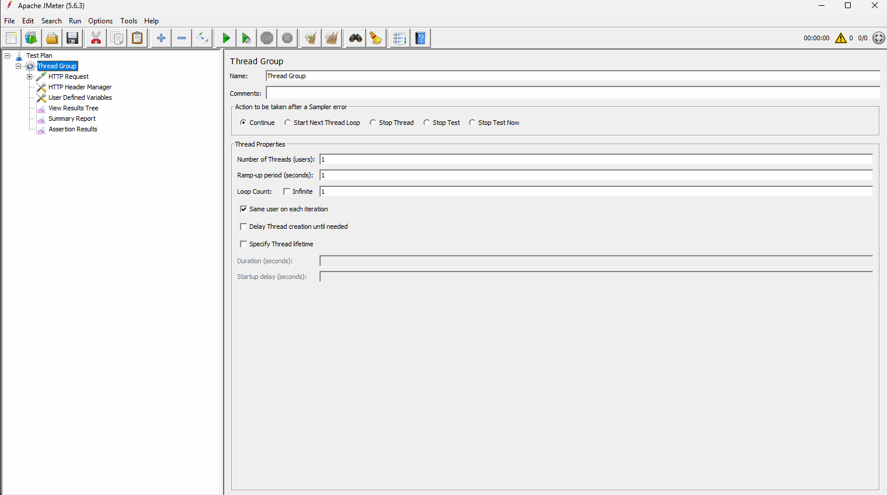
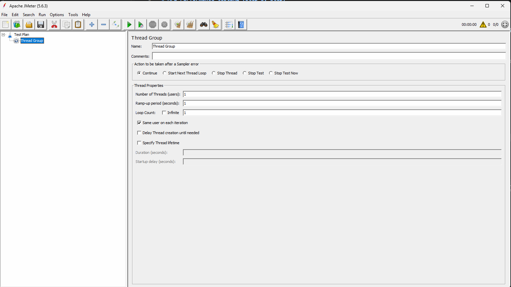

# API Performance testing (Step by Step)

## What is performance testing? 
Performance testing is all about validating the application in such a way that , When multiple users are trying to access our application at a time, how exactly is our application responding back? 

In short, performance testing is all about how fast the application is responding to each and every instruction provided by multiple users at a time. It is also about how stable our application is when multiple users are trying to request different types of information from the application continuously. 

## Different types of performance testing techniques ?

1. Load testing => Load testing is all about testing the application under expected user load by gradually increasing the load. 

For example, the maximum capacity of our application is 100 users. In this case, we are going to start with 10 users initially and slowly, gradually, we are going to increase the user count up to 100 users in the next 30 seconds. Verify how the application is responding back. The main goal of load testing is just to verify the response time and stability of our application when we are gradually increasing the load up to the maximum limit. 

2. Stress testing => Stress testing is a concept of pushing our system beyond the limit to understand the breaking point. 

For example, the capacity of our application is 100 users. Now, we are going to add 10% more users. Gradually, we are going to increase even more, and we are going to verify application behavior with this additional load. We'll try to understand what the breaking point is, where exactly the application is not going to respond. 

3. Spike testing  => Spike testing is all about validating the API by suddenly increasing or decreasing the load. 

The best example for spike testing is the flash sale happening on Amazon or Flipkart websites at midnight to 1:00. 

4. Soak testing or Endurance testing => Endurance testing is all about running the application with a particular load for a longer duration continuously. The main goal of endurance testing is understanding the application performance and the degradation of application performance when we are going to maintain the same load for so long. 

## What are all the tools available in the market to complete performance testing? 
1. Apache JMeter 
2. HP Load Runner 
3. BlazeMeter 

## What is JMeter, and how will the JMeter tool work? 
JMeter is a tool that is going to help us to validate the application performance by simulating multiple users virtually. This JMeter tool is an open-source performance testing tool. Mainly, this JMeter tool will be used to validate the performance of our application APIs or web services. 

## How to perform API performance validations using JMeter? (step by step)

-Pre-requesites:
1. We need to install JDK before running JMeter. (https://download.oracle.com/java/27/latest/jdk-27_windows-x64_bin.exe)
2. Download the JMeter zip file. (https://dlcdn.apache.org//jmeter/binaries/apache-jmeter-5.6.3.zip)

## How to launch the JMeter tool? 
- Extract the files from the JMeter zip file. 
- Navigate to the subfolder 'bin' 
- Double-click on the 'ApacheJmeter.jar' or 'Jmeter.bat' file. 
- Wait until the JMeter UI is launched with a test plan template. 

### What is test plan in JMeter? 
A test plan in JMeter is a template or root folder that will have different components to maintain the total number of virtual users, different API collections, the assertions that you want to validate, and test result report-related components. 

Within the test plan, we can add different components like 

- Thread group (Thread group is a template that consists of the total number of threads or virtual users that we want to add to complete the API performance testing. )
- Samplers (Samplers are a set of templates to send different types of requests within the JMeter tool, like HTTP request, FTP request, SMTP request, etc. )

- Configuration elements (Set of templates available in the JMeter tool to maintain the test data and Configuration data )

- Assertions (Assertions are default JMeter methods to validate the output response received in JMeter. )

- listeners (Listener is a component that will help us to monitor the test execution and also capture the test results. )

### What is a thread group in JMeter, and how to set up? 

Thread group is a template where we are going to add multiple details, like:
- Total number of virtual users we want to deploy
- Ramp-up period, meaning how much time we want to use to deploy these many users
- How many iterations, meaning totally how many times you want to repeat this entire process

- Details to be filled within the thread group template 

1. Name : Name of your project or purpose of running the specific API requests by using the JMeter tool 
For example, for our current project: API performance testing for a GitHub application 

2. Comments : Short description about your project and the API requests that you are planning to validate by using the JMeter tool 
For example, in our current test plan, I am planning to validate different scenarios related to GitHub repositories and respective API performance validations. 

3. Action to be taken after sampler error : What should happen when your request is failing in the middle of the execution? 
Continue (default) : Ignore the error and continue the execution for the remaining API request with all the remaining users. 
Start next thread loop. => Stop the current iteration and start the next iteration. 
Stop thread => Stop the entire thread execution for the current User

4. Thread properties (Most important part of the thread group )

- Number of threads (Number of virtual users ) : How many virtual users do we want to create and deploy? 
Ex: 100 (We are planning to create 100 virtual users to test the APIs. )

- Ramp up Period (in Seconds) : Total time to deploy all the users that we have created in the previous step 
Ex: 10 (That means I want to deploy 100 users in 10 seconds. That means, per second, I am going to deploy 10 users. )

- Loop Count(Number of iterations ) : Total number of iterations to be executed to repeat the same process 
Ex: 2 ( That means I want to repeat this process two times for the same 100 users with a 10-second ramp-up period. )

5. Same user on each iteration : That means the same virtual users will be repeated in each and every iteration instead of creating a new user for each iteration. 

6. Delay thread creation until needed : Whenever we are going to create 100 users and you want to deploy in 10 seconds, that means every second we need only 10 users. Instead of creating all 100 users initially, whenever it's needed, I am going to create only 10 users, and I am going to deploy the same. 

7. Specify thread lifetime. 
- Duration => Duration is all about the total time that you want to spend to deploy multiple users to test the application, or simply how much time you want to run this entire Jmeter test execution process. 
- Start-up Delay => Delay before each and every test begins. For example, if I am going to add 2 seconds, that means every time it is going to wait for 2 seconds, and then only it is going to deploy the user to test the API request. 

### Configuration elements 
Configuration elements are all about a set of templates which we are going to use to maintain configuration data or common data, which we can reuse across each and every API request. 

### Sampler in Jmeter tool 
Samplers are all about a set of templates which we are going to use to update the APA request details within the JMeter tool to send different types of APA requests to get the data from the server. 

Ex: Sending an API request from the JMeter tool. For that, we need to choose the HTTP template and fill in the details below. 

1. Name : Name of the API request or functionality of the API request 
Ex: Request to update the GitHub repository details. 

2. Comments : Short description about the functionality of a specific API request which we are trying to trigger from the JMeter tool 
Ex: As part of this request, I am trying to validate the API request related to updating GitHub repository details 

3. Protocol : (http /https) We need to update the protocol of your API request. 
Ex: https

4. Server name  : Server name is all about the base URL that needs to be updated within the API request to connect to the server. 
Ex: api.github.com

5. HTTP request method : The type of API request we are planning to send:
- GET
- POST
- PUT
- PATCH
- DELETE

6. Path : Path meaning the endpoints to be updated to get a particular piece of data from the server 

7. Body Data : Request body or payload that needs to be shared with the backend server to store some information or to update some existing data 
Ex: 
{
    "description":"updated-repo",
    "private": false
}
